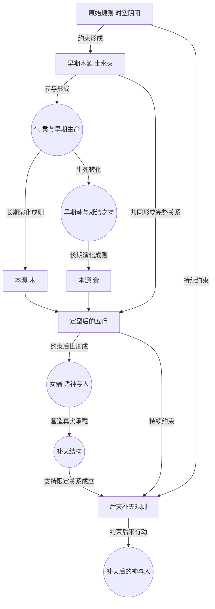

# 九州志创世与时代总表

本页是生成顺序、跨时代先后、历史分期及称号衔接的唯一总表。时代总体定位来自[创作基础 B03 至 B07](../00_项目管理/创作纲领.md)；具体分界与若干衔接仍为推荐工作稿。本文不填尚无依据的精确年份。

## 创世生成次序

采用[规则层级与年代分离](../01_世界设定/规则与存在.md#ont-02)的当前工作解释。原始规则、本源规则、存在与神的具体定义均回到各自主条目；本表只固定它们之间的先后约束。

| 阶段 | 规则一侧 | 存在一侧 | 因果边界 |
| --- | --- | --- | --- |
| 混沌与太一 | 规则与原初存在逐渐分化，天道开始成为可延续的秩序 | 原初整体尚未分出后世天地万物 | 不描述为一个绝对无规则的物体在普通时间里自行行动 |
| 原始四则 | 时空阴阳确立基本约束 | 分化、位置、先后与相对作用开始可成立 | 日月不是【时】或【阴阳】的创造者 |
| 初始三行 | 土水火在原始约束下逐步成立 | 天地、日月、水体、火焰与早期物质世界逐渐形成 | 大地显出空间展开，日月提供历时尺度；不倒过来创造原始规则 |
| 气与灵生 | 较早规则交织，不要求立即新增另一项本源 | 气成为真实媒介，特定过程形成灵 | 灵是生成的新存在，不是给“生命活性”换名 |
| 先植先兽 | 依已有规则允许有限生长、感应与存续 | 出现较脆弱、依赖环境的早期生命；死亡产生先驱魂 | 不先使用尚未成则的完整木金能力解释它们 |
| 木成其则 | 生长与延续的关系逐渐稳定，进入本源形成过程 | 植物生死、再生、灵的存续与传播共同参与 | 死亡是环节之一，木不只由死木堆积产生 |
| 金成其则 | 魂经历转化仍能凝定、重组的关系逐渐稳定 | 魂、阴地和承载物形成新的凝结与留痕过程，后有稳定金属等表现 | 不把每个魂凝块都先叫作完整【金】，也不把所有金属都视为清醒魂 |
| 五行定型 | 五行成为成熟世界相互支撑的基础 | 生命与魂的存续方式更加丰富 | 此后不因新增法术、神或材料而自动新增第六行 |
| 女娲醒世 | 已成五行被一个神圣主体协调运用 | 众魂与实际依托形成女娲，女娲造人 | 女娲是存在，不是【土】规则的人格本体 |
| 诸神与补天 | 在本源之上形成后天禁限 | 水火神、氏族与神战出现；女娲建立补天结构 | 补天改变神与人界的作用关系，不重写原始时空 |

表中每一阶段都可包含漫长重叠过程，不是几次互不相干的瞬间。涉及规则生成的关系图应注明阶段，避免把“先驱现象导致后来成则，后来规则又帮助后世存在”的时间顺序画成同一时刻的循环前提。

图中的合流表示共同成立，不表示方框是可熔合的材料。图示约定见[规则与存在](../01_世界设定/规则与存在.md#ont-01)；此图仅维护演化先后和依赖。

木与金的过程可以有长期重叠，当前排序不宣称所有地区同日完成。早期魂、生命和凝结物的出现，与规则取得普遍基础地位，是不同的历史节点；后世每个个体无需重演整个创世过程。

“道生一、一生二、二生三”保留为世界内创世叙述。“三”可在可见叙事中指日、月、地，在作用叙事中指阴、阳与土；两者不是同一类别的三个对象。神话文辞与作者层因果关系分开记录。

## 时代划分与事件先后

| 时间层次 | 推荐覆盖范围 | 能力与社会的主要变化 |
| --- | --- | --- |
| 神话时代 | 创世、五行形成、女娲与造人、水火启民、神战补天 | 早期世界形成；成熟神可以直接行动，补天后发生结构性限制 |
| 传说时代前段 | 千年氏族战争、神农事业、木神兴起、金神与轩辕 | 神间接影响，人间英雄与氏族成为主要行动者 |
| 传说时代中后段 | 五帝、大洪水、禹与九州、夏商及封神相关转折 | 国家与修习制度发展，神授中介、独立修习和魂的归属展开竞争 |
| 史诗时代 | 封神后逐渐稳定的制度世界及多个朝代与国家故事 | 神权失去直接支配的中心地位；个体、组织与国家在较稳定边界中行动 |
| 近代 | 首作所在时期，位置另行确定 | 沿用史诗基本规则，具有更具体的社会与力量条件 |

此表是推荐分期。近代在历史命名上位于史诗之后，在力量规则上继承史诗；不自动意味着工业化、火器普及或某个现实朝代。世界结构性转折与各地政权更替可以不同步。

## 人物称号氏族与王朝衔接

| 名称 | 本轮建议身份 | 避免的混淆 |
| --- | --- | --- |
| 神农 | 关键人物及其留下的氏族、技艺和共同体传统 | 不把以后每一任领袖都当作最初那一个人 |
| 炎帝 | 神农传统后期的领袖称号；当前故事可选其中一位具体人物 | 不自动等于火神，也不必等于最初神农本人 |
| 轩辕黄帝 | 金神兴起与多方冲突时期，整合五行知识及人间秩序的关键领袖 | “融五行”不默认吞并五神或获得无限权限 |
| 五行主神 | 土、水、火、木、金五个影响特殊的神格 | 不等于后世五帝，也不代表世界只有五个神 |
| 五帝 | 轩辕之后的人间秩序与领袖谱系，具体名单和继承关系待定 | 不把五位人间领袖机械对应成五神化身 |
| 禹与夏 | 大洪水、治水、九州安排之后，进入夏的王朝阶段 | 避免在轩辕和禹两处重复开创同一个夏朝 |

此处按[待决 D07](../00_项目管理/决策与待办.md#d07)的推荐顺序排表，解决原输入的两次建夏冲突；仍不是已确认的全部王朝正典。

九州当前沿治水事业中的地理、交通与治理划分展开，具体边界与名称未定，后世疆界可以变化；不由“九州”之名倒推出九块大陆或九种生命。

水火两神的具体诞生先后、各代氏族领袖的寿命、五帝名单和夏的实际建立过程尚未定。神名、个人名、传承称号、氏族和王朝不得合并成一个寿命无限的角色。

## 后世转折的预留

“巫灭道生”建议理解为神授中介体系失去某种政治或知识垄断，独立理解五行、修习自身的道路上升；原有巫术、身体训练、祭礼和部分组织仍可能存续。这样能够与后来的强大巫师并存。

封神也需要成为一次制度与力量条件的改变，而不仅是列出一张神名单。可研究的方向包括：神的活动被限定于明确依托，真实魂的去向出现新安排，人间能继承部分曾被神系垄断的知识。若出现新的后天规则，须另说明其新关系、承载和失效条件；不能仅凭册封名号就认定造法完成。具体机制留给传说时代设计。

低魔阶段应表现为直接可用、便于个人携带的超常力量受到更多条件约束。知识与集体能力可以继续发展，与“保留希望”的基调相容。

夏商更替、商汤与伊尹相关人物功能、周与封神、三教式微及东周春秋战国方向，继续保留为创作者提出的后续历史线；没有展开的部分不补成确定事件。现实朝代名称在本项目中的制度内容与时间跨度仍需独立设计。修习方向本身见[生命与神圣存在](../01_世界设定/生命与神圣存在.md#life-06)。

## 能力变化与年表维护

每次时代转折要说明改变的是力量来源、取得条件、使用方式、稳定性还是组织结构；同时交代影响对象、继续有效的遗产、逆转条件及地区差异。不得仅用“古人更强”解释全部历史，也不得默默替换原始规则。

各时代的常规能力、个人极限、集体能力、条件性奇迹及禁止项尚待填写，使用[时代能力卡](../00_项目管理/创作模板.md#template-power)。早期候选中的具体战力尺度未被自动迁入。

规则形成、具体存在生成、神格诞生分别记事件，并写清先于／后于关系；神的生日不能用作同名规则的生日。局部年表只保存地区特有事件和指向本总表的引用，不另抄完整创世与王朝序列。
